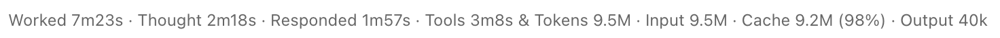

# turn-timing

[中文](README.zh-CN.md) · [日本語](README.ja-JP.md)

`turn-timing` places one compact, configurable timing row at the end of the reply body after each completed reply. It appears only after a reply finishes; active cards stay clean.

## Effect



```text
Worked 7m23s · Thought 2m18s · Responded 1m57s · Tools 3m8s & Tokens 9.5M · Input 9.5M · Cache 9.2M (98%) · Output 40k
```

Optional token metrics follow on the same line when the engine reports usage. The plugin adds only this line; it does not add the reply body above it. It uses caption-sized dim text and wraps on narrow layouts. It is display-only: it does not enter the transcript file or the model's context.

## Installation

Requires Claude Code 2.1.275+ for one-step marketplace install. The hooks API targets Claude Desktop Code tab's bundled Claude Code 2.1.321.

```bash
/plugin marketplace add ideshun/claude-code-mods
/plugin install turn-timing@claude-code-mods
```

Select the user scope, then set options in the Plugins settings. New sessions load the plugin from the user scope automatically. The Desktop Code tab can use user-scope plugins but does not offer `/plugin install` itself.

For development:

```bash
claude --plugin-dir /path/to/claude-code-mods/plugins/turn-timing
```

## Configuration

| Option | Values | Default | Meaning |
| --- | --- | --- | --- |
| `language` | `Auto`, `中文`, `English`, `日本語`, `Custom` | `English` | Language for the timing labels; `Auto` follows your system language, `Custom` uses the four label fields |
| `showTokens` | boolean | `true` | Show total, input and output tokens plus the cache-hit rate after the timing |
| `maxSessions` | Nonnegative integer; `0` = unlimited | `20` | Saved sessions, newest writes first |
| `maxTurns` | Nonnegative integer; `0` = unlimited | `50` | Saved turns per session |
| `prefix` | string | empty | Optional text/emoji before the timing line |
| `totalLabel` | string | empty | Custom total-time label |
| `thinkingLabel` | string | empty | Custom thinking-time label |
| `respondingLabel` | string | empty | Custom response-time label |
| `toolsLabel` | string | empty | Custom tool-time label |

Only `Custom` uses the four label fields, and all four must be non-empty. Legacy values `auto`, `zh-CN`, `en`, `ja-JP`, `custom` remain accepted for existing settings.

Example `~/.claude/settings.json`:

```json
{
  "pluginConfigs": {
    "turn-timing@claude-code-mods": {
      "options": {
        "language": "English",
        "showTokens": true,
        "maxSessions": 0,
        "maxTurns": 0,
        "prefix": "⏱",
        "totalLabel": "Total",
        "thinkingLabel": "Think",
        "respondingLabel": "Reply",
        "toolsLabel": "Tools"
      }
    }
  }
}
```

## What is measured

| Field | Source |
| --- | --- |
| Total | Engine-provided `turn.complete.durationMs` wall-clock duration |
| Thinking | Streamed `thinking` chunk time |
| Responding | Streamed text and tool-call chunk time |
| Tools | Main-loop tool-call execution time; concurrent calls count wall-clock time once |
| Tokens | `turn.complete.usage` total = uncached input + cache write + cache read + output |
| Cache hit | `cache_read_input_tokens / (input_tokens + cache_creation_input_tokens + cache_read_input_tokens)` |

Each completed reply receives timing on its final text block. Stored row IDs are preferred; when the host omits the API message ID, a unique matching final text can bind a late render. A bound row stays on one block per surface. Subagent turns are ignored. Token usage is the engine's turn total; absent usage hides token metrics. Thinking and responding count observed streaming time only; network waits and other unclassified time remain in Total, so the parts may sum to less than Total.

## Verification

From the repository root, run all checks with the target host's Claude Code binary:

```bash
CLAUDE_BIN="/path/to/desktop-bundled/claude" ./scripts/verify.sh
# Also compare a local installation's manifest, hook and types:
CLAUDE_BIN="/path/to/desktop-bundled/claude" ./scripts/verify.sh "/path/to/installed/turn-timing"
```

This requires TypeScript (`tsc`) and the host-generated `.claude-plugin/types`. Before publishing, use a new version number and tag, install the candidate from a clean marketplace checkout, compare the installed files, and verify two successive replies in a new Desktop session. Repeat after update and reinstall; unit tests alone do not verify Desktop rendering.


```bash
claude plugin validate plugins/turn-timing
claude plugin test plugins/turn-timing
```

Tests cover one row per reply, independent values, history repaints, language precedence, overlapping tools, native language names, `Auto`, custom labels, hidden in-progress state, subagents and interruptions.

## Limitations

- `maxSessions` (default 20) and `maxTurns` (default 50) accept nonnegative integers; `0` means unlimited. Invalid negative or fractional values fall back to defaults. Limits apply at session start and turn completion; raising them cannot recover pruned records.
- Timing is saved per turn under `${CLAUDE_CONFIG_DIR:-~/.claude}/turn-timing/history`, avoiding the host’s 4 MiB key-value store limit. `/clear` erases the current session’s saved content; empty files can remain after cleanup. An oversized reply omits only its text-matching body, retaining timing and message IDs.
- If IDs are unavailable and identical final texts are ambiguous, the plugin omits timing rather than guessing.
- At most 256 render candidates are tracked for an active turn; use a stable host message ID if larger transcripts require more.
- Thinking/responding/tool splits are client-side estimates; total is authoritative.
- The terminal renderer ignores `size="caption"`; Claude Desktop uses caption-sized text.
- A paused or sleeping computer is measured as elapsed wall-clock time.
- Timing is kept in session state; it is not a permanent conversation history.

## License

MIT. See [LICENSE](LICENSE).
